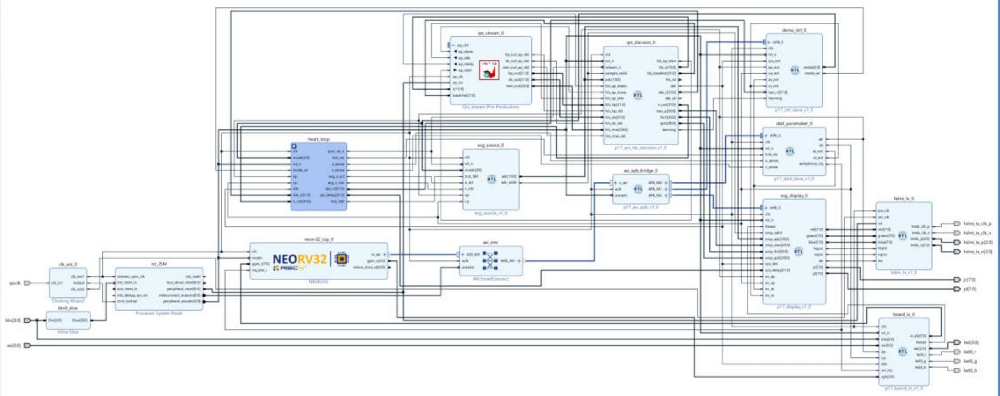
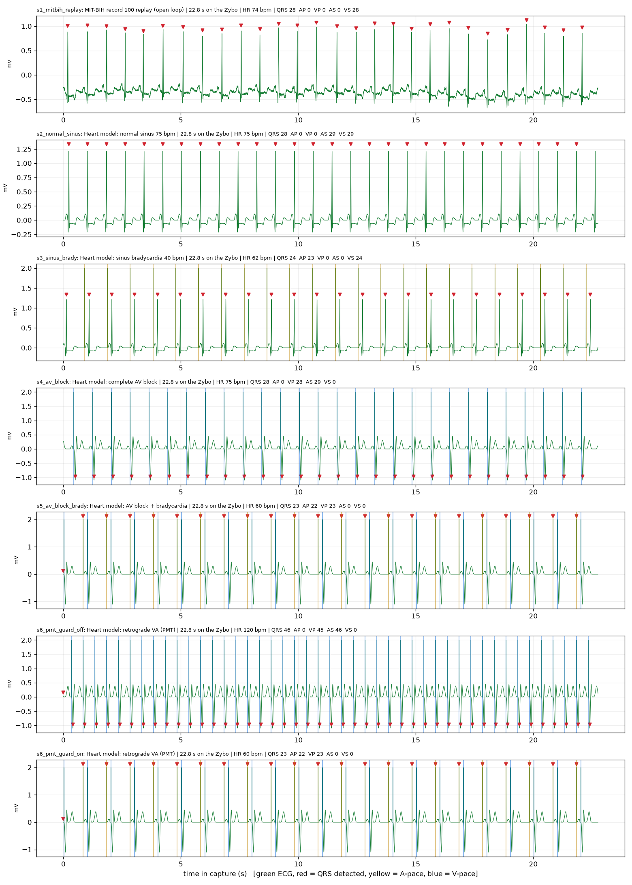

# FPGA QRS Detector and DDD Pacemaker Controller

A real-time ECG beat (QRS) detector and a dual-chamber (DDD) pacemaker controller, built as a
RISC-V system-on-chip on a **Digilent Zybo Z7-10 (Zynq-7010, xc7z010)** and verified with
simulation, assertions, coverage, model checking and k-induction proofs.

Course project P17 of *VL401: RTL Design and Verification*, IIT Mandi (Odd Semester 2026,
instructor Dr. Bikram Paul), by **Garigipati Uma Bharathi** and **Zeet Mandhana**.
The full report is [`report/VL401_G17_P17/VL401_G17_P17.pdf`](report/VL401_G17_P17/VL401_G17_P17.pdf).

## Results

| | |
|---|---|
| **QRS detector** | Pan–Tompkins in hardware (Vitis HLS filter chain + RTL adaptive thresholds). Se **99.55 %**, +P **99.92 %** on 5 MIT-BIH records (11,873 beats, ±150 ms) |
| **Paper vs baseline** | Adaptive dual thresholds cut false detections from **1,541** (fixed threshold) to **9** |
| **Hand HLS** | Filter datapath scheduled and bound by hand: one multiplier, critical path **98 → 8** control steps |
| **Pacemaker** | DDD controller (LRI / AVI / URI / PVARP / VRP) in closed loop with a hardware heart model; ESPRESSO-minimised event-priority logic (9 products / 34 literals) |
| **RISC-V** | NEORV32 RV32I over AXI-Lite → APB writes range-checked parameters; an interrupt handler turns a 120 bpm pacemaker-mediated tachycardia back into 60 bpm |
| **HW vs SW** | Hardware detector: 18 cycles/sample vs 1,383 in software on the same core (**77×**) |
| **Verification** | 300,000-tick constrained-random simulation, 19 SVA assertions, **100 %** statement/branch/condition coverage, 12 NuSMV CTL properties with fairness, SymbiYosys k-induction for every legal 16-bit parameter set. Found and fixed **2 RTL bugs** |
| **FPGA** | SoC: 6,772 LUTs (38 %), 25 MHz, timing met, 0.355 W (Vivado estimate). Measured on the board with ILA/VIO over JTAG in 7 scenarios |

## Architecture



MIT-BIH ECG is replayed from BRAM at 360 Hz into the HLS filter IP (`qrs_stream`) and the RTL
decision stage (`qrs_decision`). Detected beats are the ventricular sense of the DDD controller
(`ddd_pacemaker`), which runs against a hardware heart model (`heart_model`). The NEORV32 core
programs the controller over APB and handles its arrhythmia interrupt.

## Board measurements



Each panel is a 22.8 s ILA capture (8,192 samples, one per ECG sample) rebuilt in Python with
`tools/plot_ila_ecg.py`: MIT-BIH replay, normal sinus, bradycardia (atrial pacing), AV block
(ventricular pacing), AV block + bradycardia, and PMT with the software guard off and on.

## Repository layout

| Folder | Contents |
|---|---|
| `src/` | Python golden models: ECG loader, Pan–Tompkins (float and integer), streaming detector model, DDD pacemaker, heart model, explicit-state CTL checker, event-priority logic (QM + ROBDD) |
| `tests/` | 48 pytest checks of the golden models |
| `data/` | MIT-BIH records 100, 101, 106, 208, 234 (PhysioNet) |
| `hls/` | Vitis HLS kernels `qrs_filter` and `qrs_stream`, testbenches and run scripts |
| `rtl/` | Verilog RTL and testbenches; `rtl/bd/` block-design modules; `rtl/firmware/` NEORV32 firmware (C) |
| `vivado/` | Tcl/batch flows: projects, block design, ILA/VIO, bitstream rebuild, ILA capture; XDC files |
| `vivado/zybo_reports/` | Final bitstream + ILA probe file, utilisation / timing / power reports |
| `report/work/` | Experiments of the report: `paper`, `sim`, `hand_hls`, `fsm_logic`, `formal`, `hwsw`, `lint`, `refs`, `figs`, `board_fixed` (most have a `RESULTS.md`) |
| `report/VL401_G17_P17/` | Report LaTeX source, figures and PDF |
| `results/` | Logs, plots and the board ILA captures (CSV + PNG) |
| `neorv32_ip/` | NEORV32 core packaged as a Vivado IP with our firmware image (third-party, BSD-3-Clause) |

## How to run

Tested on Windows 11 with Vivado / Vitis HLS 2025.2, Python 3.14, NuSMV 2.7.1 and the OSS CAD
Suite (Yosys, SymbiYosys, Verilator). Run from the repository root:

```
python -m venv .venv && .venv\Scripts\pip install -r requirements.txt
.venv\Scripts\python -m pytest tests -q                       # golden models (48 tests)
.venv\Scripts\python src\evaluate_hw_detector.py              # Se/+P on 5 MIT-BIH records
.venv\Scripts\python report\work\paper\baseline_eval.py       # baseline vs Pan-Tompkins
.venv\Scripts\python report\work\sim\run_regression.py        # xsim testbenches, SVA, coverage
.venv\Scripts\python report\work\hand_hls\hand_hls.py         # DFGs, schedules, ILP, binding
NuSMV -dcx report\work\formal\ddd_oa.smv                      # CTL properties
report\work\formal\sby\run_demo.bat                           # SymbiYosys proofs
hls\run_hls_z7.bat                                            # HLS IP (csim, csynth, export)
vivado -source vivado\create_zybo_bd.tcl                      # SoC block design + bitstream
vivado -mode batch -source vivado\ila_capture_batch.tcl       # board ILA captures
```

The scripts were written with the project at `C:\Vivadoproject\P17_QRS_Pacemaker`; some
testbenches (`TB_DIR`) and Vivado Tcl files use that absolute path, so edit it if you clone
elsewhere. Vivado/HLS project folders, simulator snapshots and SymbiYosys work folders are not
in the repository; the scripts recreate them. Debug cores need the JTAG clock at 5 MHz (the
capture scripts set it).

## Limitations

- The HDMI display was checked in simulation only (no monitor in the lab); board results come
  from the ILA.
- Power is Vivado's vectorless estimate.
- The detector was scored on 5 of the 48 MIT-BIH records, one lead.

## Credits

NEORV32 RISC-V processor by Stephan Nolting (BSD-3-Clause); MIT-BIH Arrhythmia Database from
PhysioNet (Moody and Mark; ODC-By 1.0); the course's Digital Logic Synthesis Kit (not included);
NuSMV, Yosys and SymbiYosys. Algorithm: J. Pan and W. J. Tompkins, "A real-time QRS detection
algorithm," *IEEE Trans. Biomed. Eng.*, 1985.
